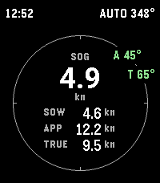
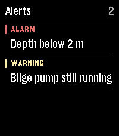

# PebbleK


A [SignalK](https://signalk.org/) app for Pebble. Monitor your boat from your wrist and control your autopilot.

Install it from the Pebble App Store: [https://apps.repebble.com/bef8e6181d804c4aaa40c482](https://apps.repebble.com/bef8e6181d804c4aaa40c482)

| Autopilot off | Autopilot engaged |
| :-----------: | :---------------: |
|  |  |

## Instruments (home)

On Pebble Time 2, the home screen shows speed over ground (SOG) in the center of
a single ring. Speed through water (SOW), apparent wind speed (APP), and
water-referenced true wind speed (TRUE) appear below it, all in knots.



The ring shows apparent (A) and true (T) wind angles relative to the boat.
Ahead is at the top, port is to the left in red, and starboard is to the right
in green. Labels separate when the two bearings are close. The header shows
the clock, pilot mode, and active target when available. Pebble Round 2 uses
a four-quadrant panel for the same instruments.

From instruments, press **Up** for the pilot or **Down** for active alerts.
**Back** returns to instruments and cancels any unsent pilot adjustment.
Back from home exits the app.

Each reading expires **10 seconds after its Signal K source timestamp**. A missing or expired speed shows
`--`. On the rectangular watch an expired angle disappears from the ring,
and expired measurements show a `DATA STALE` status. Wind speed and angle
expire independently. Stale pilot status displays `PILOT --` and prevents
control commands.
Connection recovery does not revive old readings. The watch expires data even
when the phone stops delivering messages. Boat, phone and watch clocks should be
synchronized; timestamps more than five seconds in the future are rejected.

The server must supply `navigation.speedThroughWater`, `navigation.speedOverGround`,
`environment.wind.speedApparent`, `environment.wind.angleApparent`,
`environment.wind.speedTrue` and `environment.wind.angleTrueWater`. True wind is
read from Signal K, not estimated from SOG. Missing sensors remain unavailable.

## Alerts

While PebbleK is open, it monitors Signal K notifications for your own vessel.
Press **Down** from instruments to see active alerts, most severe first. Use
**Up** and **Down** to browse and **Back** to return to instruments.

A newly raised alert buzzes the watch and fills the screen. Use **Up/Down** to
scroll long messages. Press **Back** to dismiss each notice and return to your
previous screen. A notice stays visible even if Signal K clears it first.
An alert that interrupts a pending pilot adjustment cancels the unsent change. Each alert buzzes again only if it reaches a higher
severity than it has already reached. Updated wording or a lower severity
updates the list quietly. When the server clears an alert, it leaves the list.
A later occurrence is a new alert. The list shows **Connection lost** if the
phone or Signal K disconnects, and **Syncing alerts** while it refreshes.




## Autopilot page

On Pebble Time 2, the wind ring stays in place when you open the pilot page.
The apparent (A) and true (T) angles remain on the rim while the center shows
the pilot readout. Its arrow and colour indicate port (red) or starboard (green).

- **AUTO:** the center shows how far you are off the desired heading, with `ON COURSE` at 0°. The header shows the desired heading.
- **WIND:** the set apparent wind angle (green starboard, red port).
- **Standby:** your current heading, in white.

After a course change, the watch displays the expected target until the autopilot confirms it. If the command fails or the target is still unconfirmed after five seconds, the watch restores the last reported target, shows **FAILED** or **REVERTED**, and gives a long buzz.

The side buttons drive a [signalk-autopilot](https://github.com/SignalK/signalk-autopilot):

| Button | Press  | Action                                                        |
| ------ | ------ | ------------------------------------------------------------- |
| Up     | short  | **+1°** (batched, see below)                                  |
| Up     | hold   | **+10°**, repeating every 0.4 s while held |
| Down   | short  | **−1°** (batched, see below)                                  |
| Down   | hold   | **−10°**, repeating every 0.4 s while held |
| Select | short  | engage AUTO / disengage                                       |
| Select | long   | engage WIND / disengage                                       |

### Dialling in a larger change (touchscreen)

On a watch with a touchscreen, **touch and drag left or right** to dial in a bigger change without sending anything yet — drag toward port for negative, starboard for positive, in 5° steps. The caption shows what will be sent (`SEND +40°`) and the number tracks the new **absolute desired heading** (e.g. `185`), green or red by which way the change turns.

| Input  | While a change is pending                                     |
| ------ | ------------------------------------------------------------- |
| Drag   | dial the change; drags add up (up to ±180°)                   |
| Up/Down| add ±1° (hold for ±10°); a batch started by buttons auto-sends |
| Select | **send** it as one adjustment (never disengages)              |
| Back   | cancel and return to instruments (also cancels by itself after 10 s)                    |

Only available on the autopilot page while the pilot is engaged (AUTO or WIND) and its status and target are fresh.

**Button presses are batched.** Up/Down don't send each press: they add up in a pending change shown in the caption as `SEND +7°` (with the number tracking the new absolute desired heading), and it's sent as one adjustment **1 second after your last press**. So tapping +1 seven times, or holding for a few +10 steps, lands as a single change and the autopilot doesn't start moving underneath you while you count. Select sends it immediately; Back cancels it and returns to instruments.

Each hold step gives a tiny tick buzz so you can count steps without looking (e.g. hold for 9 ticks ≈ 90°). Commands give a haptic confirmation: a short buzz on success, a long buzz on failure.

## How it works

- The **watch app** is native Pebble C (`src/c/`). It renders the dashboard and sends button commands.
- The **phone app** is PebbleKit JS (`src/pkjs/`). It talks to your SignalK server over a WebSocket, relays telemetry to the watch, and turns button commands into autopilot REST calls. All networking lives here.

The two communicate over Pebble AppMessage.

## Setup

Open the pebblek settings on your phone and enter your **SignalK server address** (`host:port`) and a device name. The app requests **read/write** access via the SignalK [access-request flow](https://signalk.org/specification/1.5.0/doc/access_requests.html); approve it in your server's admin UI (**Security → Access Requests**). No token to copy — once approved the watch connects automatically.

## Building & running

```sh
pebble build                          # build for all targetPlatforms
pebble install --emulator emery       # install on the emery emulator
pebble install --phone <ip>           # install to a paired phone
pebble logs                           # stream watch + phone logs
```

## Target platforms

**emery** (Pebble Time 2) and **gabbro** (Pebble Round 2). Other platforms are not supported.

## Project layout

```
src/c/main.c          Native C watch app: UI, AppMessage, buttons
src/c/protocol.h      Shared message enums/encoding (C side)
src/pkjs/             PebbleKit JS (phone): SignalK client, auth, autopilot, settings
src/pkjs/protocol.js  Shared message enums/encoding (JS side — mirror of protocol.h)
package.json          Project metadata (UUID, platforms, message keys)
wscript               Build rules — usually no need to edit
```

## Focused checks

```sh
node --test tests/telemetry.test.js
cc -Itests/stubs -Isrc/c tests/state.test.c src/c/state.c -o /tmp/pebblek-state-test
/tmp/pebblek-state-test
```

These cover unit conversion, measurement timestamps, invalid and out-of-order
data, reconnects, and independent watch-side expiry when the phone goes silent.
