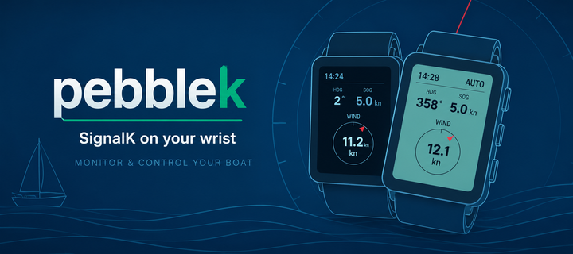
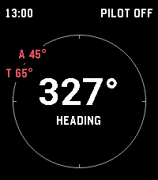
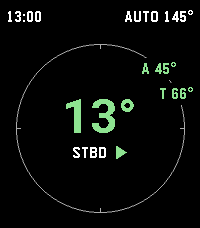

# PebbleK



A [SignalK](https://signalk.org/) app for Pebble. Monitor your boat from your wrist and control your autopilot.

Install it from the Pebble App Store: [https://apps.repebble.com/bef8e6181d804c4aaa40c482](https://apps.repebble.com/bef8e6181d804c4aaa40c482)

| Autopilot off | Autopilot engaged |
| :-----------: | :---------------: |
|  |  |

The watch shows boat **heading**, **autopilot status**, **speed over ground**, and **wind speed & direction**. The whole screen turns green while the autopilot is engaged. The side buttons drive a [signalk-autopilot](https://github.com/SignalK/signalk-autopilot):

| Button | Press        | Action                            |
| ------ | ------------ | --------------------------------- |
| Up     | short / long | adjust heading **+1°** / **+10°** |
| Down   | short / long | adjust heading **−1°** / **−10°** |
| Select | press        | engage / disengage autopilot      |

Each command gives a haptic confirmation: a short buzz on success, a long buzz on failure.

## How it works

- The **watch app** is native Pebble C (`src/c/`). It renders the dashboard and sends button commands.
- The **phone app** is PebbleKit JS (`src/pkjs/`). It talks to your SignalK server over a WebSocket, relays telemetry to the watch, and turns button commands into autopilot REST calls. All networking lives here.

The two communicate over Pebble AppMessage.

## Setup

Open the pebblek settings on your phone and enter your **SignalK server address** (`host:port`) and a device name. The app requests **read/write** access via the SignalK [access-request flow](https://signalk.org/specification/1.5.0/doc/access_requests.html); approve it in your server's admin UI (**Security → Access Requests**). No token to copy — once approved the watch connects automatically.

## Building & running

```sh
pebble build                          # build for all targetPlatforms
pebble install --emulator emery       # install on the emery emulator
pebble install --phone <ip>           # install to a paired phone
pebble logs                           # stream watch + phone logs
```

## Target platforms

**emery** (Pebble Time 2) and **gabbro** (Pebble Round 2). Other platforms are not supported.

## Project layout

```
src/c/main.c          Native C watch app: UI, AppMessage, buttons
src/c/protocol.h      Shared message enums/encoding (C side)
src/pkjs/             PebbleKit JS (phone): SignalK client, auth, autopilot, settings
src/pkjs/protocol.js  Shared message enums/encoding (JS side — mirror of protocol.h)
package.json          Project metadata (UUID, platforms, message keys)
wscript               Build rules — usually no need to edit
```
